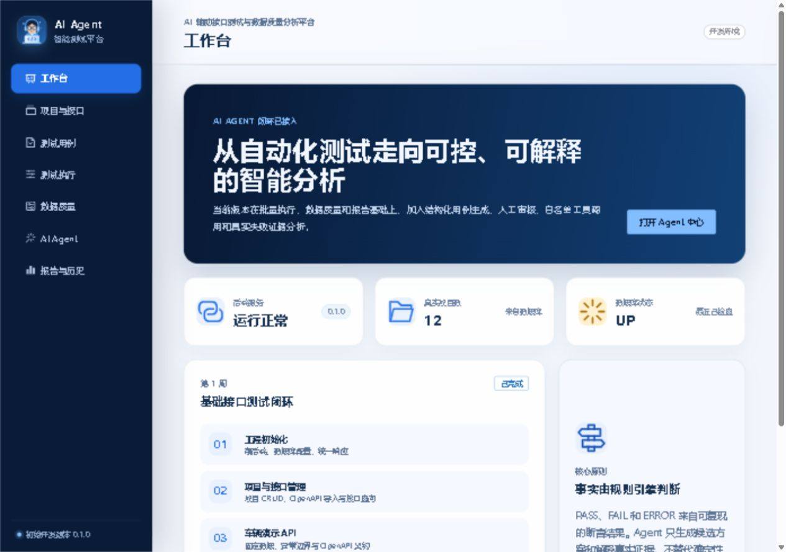
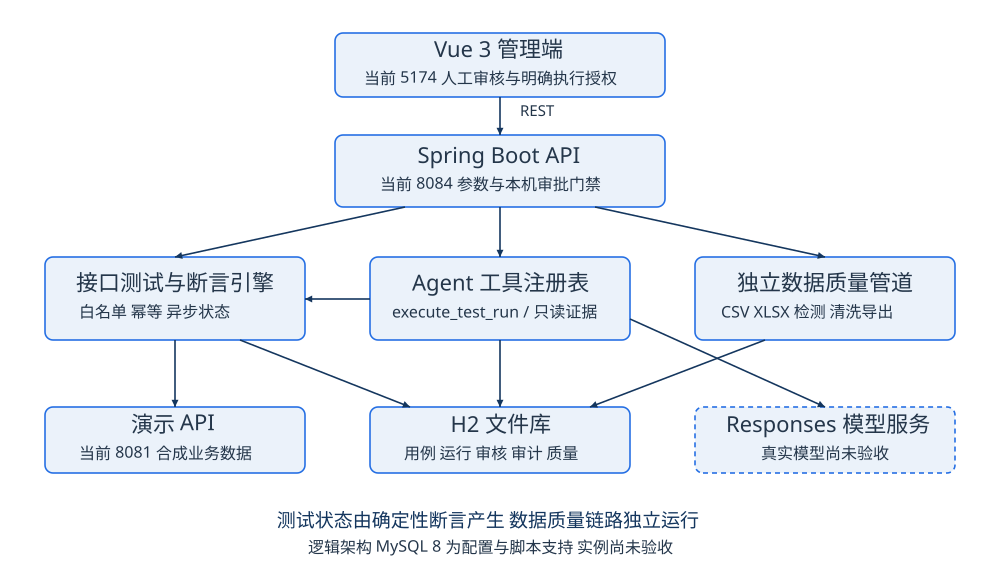

# TestData Agent · AI Agent 智能测试平台

包含自动化接口测试、AI Agent 受控执行和独立数据质量分析能力的本地演示项目。

确定性引擎负责请求、断言及 PASS/FAIL 判定；Agent 负责提出候选和解释真实证据。**真实模型成功链路尚未验收，目前模型协议闭环通过的是本机替身验证。**



## 已实现功能

- 项目与接口管理：导入受限 OpenAPI 3.x JSON，按项目登记接口契约。
- 用例与人工审核：服务端管理来源、草稿、版本和审核记录；编辑后重新审核。
- 接口测试：REST Assured 真实请求，批量异步执行、幂等防重、失败重跑和断言证据持久化。
- 确定性断言：状态码、JSONPath、JSON 值、JSON 类型、数值范围和响应时间。
- 数据质量：CSV/XLSX 解析、必填、重复键、类型及范围检测；清洗预览、CSV/XLSX 派生导出，原文件保留。
- Agent：Responses API 结构化候选、受控 execute_test_run、只读证据工具和持久化审计。
- 报告：运行统计、失败证据和 HTML 导出。预期失败仍计为 FAIL，不存在 XFAIL 排除规则。

接口测试和数据质量是两条独立业务链路，普通测试与质量检测不依赖模型。

## 架构与技术



- 后端：Java 21、Spring Boot 3.5.7、Spring Data JPA、REST Assured、JSONPath。
- 前端：Vue 3、TypeScript、Element Plus、Vite。
- 数据：默认 H2 文件库；提供 MySQL 8 配置与脚本，MySQL 实例尚未验收。
- 文件：Apache POI 处理 XLSX，Commons CSV 处理 CSV。

```text
backend/src/main/       后端正式源码与运行配置
demo-api/src/main/      合成车辆业务演示 API
demo-api/openapi.json   演示接口契约
frontend/src/           Vue 管理端
database/               MySQL 初始化及增量迁移脚本
sample-data/            合成 CSV/XLSX、规则和独立预期
docs/delivery/          正式交付说明、人工演示手册、验收记录及配套材料
```

## 环境要求

- Java 21，Maven 3.8+。
- Node.js 20.19+ 或 22.12+，npm 10+；以 package-lock.json 中的 engines 要求为准。
- MySQL 8 仅在启用 mysql Profile 时需要。

以下步骤用于**全新克隆目录**。当前维护机器的后端是 8084、前端 5174、演示 API 8081，8080 属于其他项目；不要为照抄默认端口而停止已有服务。

## 首次运行

先确认默认 8080、8081、5173 端口可用。分别打开三个终端。

### 后端

在项目根目录的 PowerShell 中显式禁用模型，并通过隐藏输入设置本地审批令牌，再启动 Java：

```powershell
$env:AI_AGENT_ENABLED = "false"
$approvalInput = Read-Host "设置本地演示审批令牌" -AsSecureString
$env:LOCAL_APPROVAL_TOKEN = [Net.NetworkCredential]::new('', $approvalInput).Password
Set-Location .\backend
mvn spring-boot:run
```

健康接口为 `http://127.0.0.1:8080/api/v1/health`。默认 dev Profile 绑定回环地址，在后端工作目录的 `.data/testdata-agent.mv.db` 保存 H2 文件，初次启动使用 Hibernate update 建表。已有库应先备份核对，再以固定文件路径及 validate/IFEXISTS 启动，避免新建空库。

`.env.example` 仅为模板，不会自动加载。变量必须在启动 JVM 前设置；另一个终端修改环境不会热更新已有服务。

### 演示 API

```powershell
Set-Location .\demo-api
mvn spring-boot:run
```

健康接口为 `http://localhost:8081/demo/health`，接口契约是 `demo-api/openapi.json`。只使用该合成演示目标。

### 前端

```powershell
Set-Location .\frontend
npm ci
npm run dev
```

访问 `http://localhost:5173/`，`/api` 默认代理到 `http://localhost:8080`。更改端口时同步调整独立运行参数、前端代理和导入契约地址。

## 免费人工演示

1. 创建专用项目，导入 `demo-api/openapi.json`，应看到 4 个接口。
2. 创建 GET `/demo/health` 用例：正常断言期望 200，另一个故意期望 503；初始均为 DRAFT。
3. 由操作者本人检查请求和断言，在本机密码框完成人工审核；未审核用例不能执行。
4. 通过普通测试执行入口运行两条用例，预期 1 PASS、1 FAIL；展开期望 503、实际 200 的证据。
5. 查看报告，预期通过率 50%，下载 HTML 并核对实际文件。
6. 上传 `sample-data/quality-dirty.csv` 或 XLSX，按 `quality-rules.json` 配置，应检测出 6 个问题。
7. 按 `cleaning-plan.json` 预览，预期修改 2 单元格、移除 1 重复行、输出 2 行，再导出 CSV/XLSX。

清洗保留的 not-number 和 101 仍有质量问题，不能宣称已自动修复全部错误。免费演示不点击生成候选、Agent 执行及 AI 失败分析按钮。

## Agent 与安全边界

Agent 使用 Responses API、严格 JSON Schema 和服务端业务校验。候选保存为 AGENT/DRAFT，经人工审核并明确授权后，受控工具才通过原测试服务创建运行。工具参数绑定项目、用例版本、审核记录及幂等键，不能传任意主机、SQL、命令或文件路径。失败分析只读持久化脱敏证据，不写回测试判定。

真实模型配置项为 AI_AGENT_ENABLED、OPENAI_API_KEY、OPENAI_BASE_URL、OPENAI_MODEL；仅在取得费用授权后配置并验证，不将真实值写入源码、聊天或日志。`configured=true` 只说明配置非空，不能证明认证和推理成功。

本地审批令牌与回环来源检查属于演示权限边界，尚无正式账号认证或 RBAC。普通管理与证据查询不具备多用户授权隔离，不要直接公开到互联网。敏感请求字段只允许环境引用，例如 `{{env:TEST_API_TOKEN}}`，执行瞬间解析，快照与普通响应脱敏。

测试目标默认仅允许 `http://localhost:8081`，关闭 HTTP 重定向。质量文件限 10 MB、10000 行、200 列；拒绝公式、错误和合并单元格；CSV 导出处理公式注入。响应长度检查发生在完整读取之后，尚不是网络流硬内存上限。

## 数据库初始化与迁移

当前实际验收的是 H2。MySQL 配置由 DB_HOST、DB_PORT、DB_NAME、DB_USERNAME、DB_PASSWORD 提供，mysql Profile 使用 validate。

- MySQL 新库执行 `database/schema.sql`；脚本固定创建并使用 testdata_agent。
- 旧结构先检查字段，再按需执行一次 `database/migrations/001_add_review_record_id.sql`，之后用 schema.sql 补新表。
- 001 不支持重复 ALTER；当前维护机器的 H2 已迁移，不能直接再次执行。
- H2 的 MySQL 兼容模式不等于 MySQL 实例验收通过。MySQL 示例参数不作为生产安全配置。

## 构建与历史验证

本公开版本按交付要求**不包含测试源码、冒烟脚本和临时验收工具**。原测试、原 POM 及原始验收资料已归档到维护者本地恢复包，未上传；需要复跑原测试时，应在独立目录恢复完整验证环境。

在新克隆目录构建：

```powershell
# backend 和 demo-api 各自工作目录
mvn -Dmaven.test.skip=true package
# frontend 工作目录
npm ci
npm run build
```

这些命令验证公开源码可编译和打包，**不代表重跑已移除的测试**。

| 历史验证范围 | 已保留结果 | 说明 |
| --- | --- | --- |
| 完整后端测试 | 54/54，0 失败、0 错误 | 测试源码已本地归档 |
| 演示 API 测试 | 4/4，0 失败、0 错误 | 同上 |
| 前端类型检查和生产构建 | 通过 | 航天蓝主题后已复验 |
| 批量运行 | 10 条，9 PASS、1 预期 FAIL，报告90% | 确定性引擎实际结果 |
| 人工页面执行 | 2 条，1 PASS、1 预期 FAIL，报告50% | 本人审核及真实运行 |
| 模型协议专项 | 本机替身通过 | 不代表真实模型成功 |

## 正式交付材料

- [项目交付说明书](docs/delivery/01_项目交付说明书.pdf)：架构、模块、数据库、运行与安全。
- [人工演示操作手册](docs/delivery/02_人工演示操作手册.pdf)：步骤、预期、讲解词及录屏分镜。
- [项目验收记录表](docs/delivery/03_项目验收记录表.pdf)：通过、仅替身通过、未验证和阻塞项。
- [材料索引与可编辑源稿](docs/delivery/交付材料索引.md)、[验证基线](docs/verification-baseline.md)、[安全边界](docs/security-and-reliability.md)。

待完成：真实模型端到端验收、XLSX/OpenAPI 完整页面上传、CSV/XLSX/HTML 浏览器下载落盘复验、正式录屏，以及 MySQL 实例验收。开机自启和服务守护未配置。正式演示前由维护者在本机完成审批凭据安全复核与轮换。
