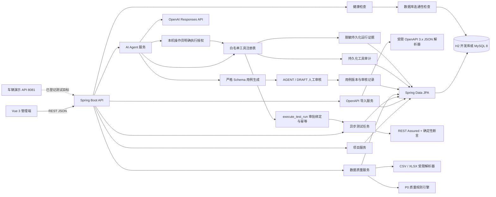
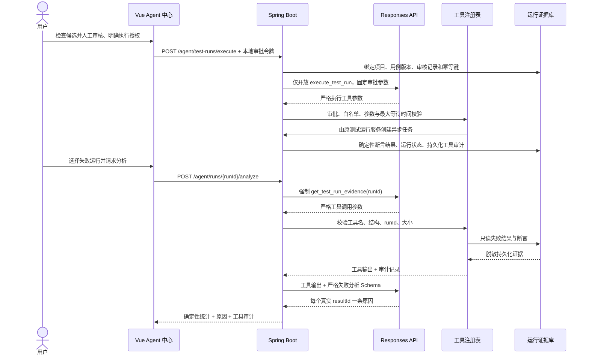

# 架构与开发约定

## 当前逻辑架构

当前测试执行和数据质量模块沿用同一单体分层方式。测试执行结果由确定性断言引擎判定，数据问题由质量规则引擎判定；Agent 只生成候选和解释这些证据，不修改 PASS、FAIL 或质量规则结果。

## Agent 闭环

- 用例生成只发送受限接口契约，不发送 base URL 或认证配置。
- 严格 JSON Schema 后仍做服务端业务校验，拒绝敏感请求头、超大请求和无效断言。
- 候选接收后固定为 `AGENT / DRAFT`，必须人工审核后才能进入执行引擎。
- 失败分析仅开放一个只读工具，并把 URL 中的 runId 与工具参数精确绑定。
- 受控执行阶段仅开放 execute_test_run，不能由模型审批、传主机/SQL/命令/路径或写入测试判定。工具创建任务后的确认回传通过 previous_response_id 与 function_call_output 继续原 Responses 上下文。
- 工具等待最多 5 秒，模型连接/读取默认分别 5/30 秒，二者是不同超时边界。执行审批和工具审计落库，支持重启后查询及幂等回放。
- 本机令牌与回环来源校验是开发演示边界，生产账号认证和 RBAC 尚未实现。2026-10-31 真实模型调用未获授权，仅完成本机替身及隔离验证。
- Agent 返回中不提供重新判定状态的字段；状态由真实证据补全。

## OpenAPI 导入边界

- 首版只接受最大 2 MB 的 OpenAPI 3.x JSON 文件
- 解析路径、HTTP 方法、参数、请求体 Schema、成功响应 Schema 和第一个服务器地址
- 同一项目内以 `method + path` 为稳定键，重复导入执行更新
- webhooks 和 callbacks 暂不导入，响应中必须返回可见警告
- 导入只登记目标，不会自动向文档中的地址发起网络请求

## API 约定

- 统一前缀：`/api/v1`
- 统一响应：`success`、`code`、`message`、`data`、`traceId`
- 每个响应通过 `X-Trace-Id` 返回请求追踪标识
- 参数错误返回稳定错误码，不向前端暴露堆栈、连接串或服务器路径
- 分页接口后续统一使用 `page`、`pageSize`，并限制最大页大小

## 数据存储

- 默认 `dev` Profile 使用项目目录下的 H2 文件库，便于首次启动
- `mysql` Profile 使用 MySQL 8，连接信息全部来自环境变量
- 业务记录统一保留 `created_at` 和 `updated_at`
- 用例和执行结果保存快照，避免配置变更破坏历史可追溯性
- 测试任务异步执行，每完成一条即持久化结果和计数；幂等键阻止重复创建
- 数据文件随机重命名保存，原文件不被覆盖；数据库保存预览、统计和问题明细

## 第二周边界

- 单批最多 20 条已审核用例；每条独立执行，失败重跑创建父子关联的新任务
- 断言支持状态码、JSONPath、值相等、JSON 类型、数值范围和响应时间
- 数据文件最大 10 MB、10,000 行、200 列；CSV 只接受 UTF-8，XLSX 只读取指定或首个工作表
- 为避免不可控计算，XLSX 公式、错误和合并单元格当前直接拒绝
- P0 规则为 `REQUIRED`、`DUPLICATE_KEY`、`TYPE_MISMATCH`、`NUM_RANGE`
- 重复检测会先删除旧问题再保存本次结果，因此重复扫描不会累加统计
- 清洗服务只在内存中生成派生数据集，支持空白修剪、空值填充和稳定去重，不写回上传文件
- CSV/XLSX 导出直接读取原始文件并应用当前清洗请求；XLSX 类型来自已保存的质量规则
- 运行报告从持久化测试结果实时汇总，不保存第二份状态；HTML 导出对动态内容执行转义

## 下一步实现顺序

1. 获得授权后完成真实模型成功调用与人工端到端验收；现有工具审计持久化已经实现
2. 整理正式交付材料；JWT/RBAC、模型调用配额、CI 和服务守护属于后续工程增强
3. PDF 报告、质量修复建议和可撤销清洗方案属于扩展功能，不作为当前本地演示完成的证明

