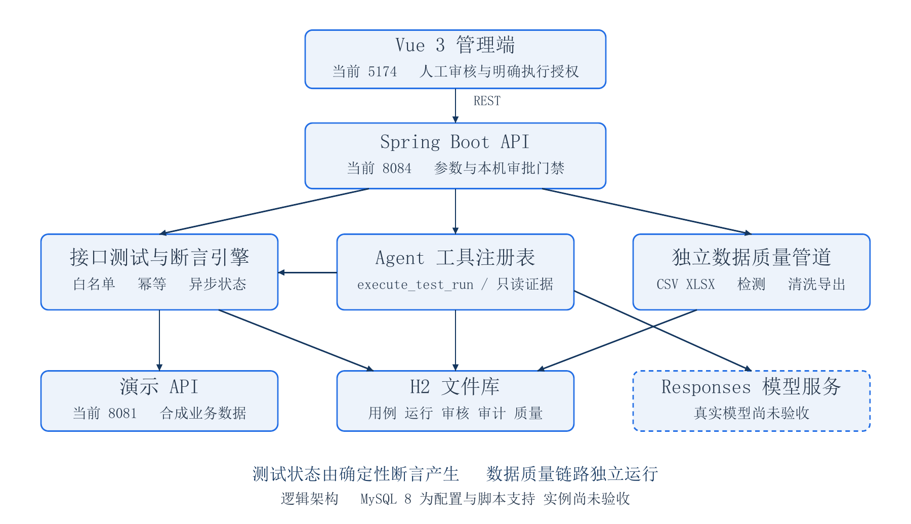

# TestData Agent 项目交付说明书

AI 辅助接口测试与数据质量分析平台

文档编号 TDA DEL 001　文档版本 1.1　产品版本 0.1.0　发布日期 2026年10月31日

## 一 交付范围与项目定位

TestData Agent 是面向本地演示的智能测试平台，包含自动化接口测试、AI Agent 受控执行和独立的数据质量分析能力。前端品牌名称为 AI Agent。项目采用单体分层后端和独立 Vue 管理端，另设合成车辆业务演示 API，便于复现正常与失败场景。

本交付说明面向项目接收者、演示操作者及技术面试官，说明现有实现、运行方式和验收边界。核心确定性功能与本机模型替身链路已有验证证据；真实模型成功调用及完整人工文件上传下载流程尚未完成最终验收。可以按说明演示本地确定性功能，完整真实 AI 验收仍需补齐。

两条业务链路分别运行。接口测试链路为接口定义、候选用例、人工审核、受控执行、自动断言、持久化审计、失败证据分析与运行报告。数据质量链路为文件上传、解析、规则检测、清洗预览与派生文件导出。数据质量检测不依赖接口测试运行或大模型调用。

### 交付内容

| 材料 | 内容与用途 |
| --- | --- |
| 项目交付说明书 | 架构、模块、技术实现、数据模型、启动与安全边界 |
| 人工演示操作手册 | 免费演示步骤、预期结果、讲解词及真实模型演示前提 |
| 项目验收记录表 | 分项状态、实际数量、证据定位、待办与签署栏 |
| 配套资料 | 架构图、可编辑 Markdown 源稿、脱敏证据摘要与文件校验清单 |

本说明书随正式源码及演示材料发布，不包含已录制的视频。公开版只保留正式源码、构建配置和必要材料；历史测试及临时验收资料已归档到维护者本地恢复包。开发数据库和原有备份留在本机，不上传。发布整理没有重新执行原54/4项测试，也没有切换运行服务。

### 当前验收结论

最近一次完整自动化基线为后端 54/54、演示 API 4/4，失败与错误均为 0。航天蓝主题修改后再次完成前端类型检查和生产构建。人工页面运行的两条用例得到 1 PASS、1 预期 FAIL，报告为 50.0%。这些结果分别对应不同范围，不合并为一次新的全量回归。

真实模型使用的配置名称不能证明模型已经调用成功。本轮文档编制未发送模型请求，历史最终阶段免付费验收记录的真实模型请求数也是 0。配置中的 gpt-6-astra 仅是待验收配置值。

<!-- PAGE -->

## 二 系统架构与模块职责



图中展示已实现的逻辑调用关系；真实模型分支的业务效果尚未验收。数据库保存用例、审核、执行、断言和工具审计。模型只能提出候选、申请已授权工具调用或解释证据，最终测试状态由断言引擎产生。

后端表内缩写路径以 backend/src/main/java/com/wxl/testdataagent 为前缀。

| 模块 | 实际职责 | 关键代码位置 |
| --- | --- | --- |
| 管理端 | 项目、接口、用例、执行、质量、Agent 与报告页面 | frontend/src/views；frontend/src/router/index.ts |
| 接口管理 | 项目 CRUD、受限 OpenAPI 3.x JSON 导入及更新 | apidefinition/ApiDefinitionService.java |
| 用例与审核 | 请求及断言保存、版本管理、草稿与人工审核 | testcase/TestCaseService.java |
| 测试运行 | 异步批量运行、幂等、失败重跑和进度落库 | testrun/TestRunService.java；TestRunExecutionWorker.java |
| 确定性引擎 | REST Assured 请求、白名单与断言求值 | testengine/HttpTestExecutor.java；AssertionEngine.java |
| 数据质量 | 文件受限解析、规则检测、清洗及导出 | dataquality/DataQualityService.java；DataCleaningService.java；DataExportService.java |
| Agent | Responses 调用、候选校验、工具执行、证据分析和审计 | agent/AgentController.java 及相关 Service |
| 报告 | 从持久化运行结果汇总指标并导出 HTML | testrun/TestRunReportService.java |
| 演示 API | 固定合成车辆业务与可复现接口响应 | demo-api/src/main/java；demo-api/openapi.json |

<!-- PAGE -->

## 三 技术实现与状态约束

后端为 Java 21、Spring Boot 3.5.7、Spring Web、Bean Validation 和 Spring Data JPA。HTTP 测试由 REST Assured 执行，JSONPath 用于结构化断言；CSV 使用 Commons CSV 1.11.0，XLSX 使用 Apache POI 5.3.0。前端使用 Vue 3、TypeScript、Vue Router、Element Plus、Axios 和 Vite。前端依赖范围见 package.json，实际锁定版本以 package-lock.json 为准。

正式接口统一前缀为 /api/v1，返回 success、code、message、data、traceId；X-Trace-Id 响应头提供请求追踪标识。

### 用例与审核

普通创建请求由服务端保存为 MANUAL/DRAFT；Agent 候选接收走 createAgentDraft，保存为 AGENT/DRAFT。公共请求 DTO 不提供客户端决定来源和审核状态的权限。编辑用例会提升版本并回到待审核状态，不能沿用旧版本的审核许可。人工审核生成 test_case_review，执行前检查用例启用状态、项目归属、当前版本及对应审核记录。

审核入口由 LocalApprovalGuard 检查回环来源与本地审批令牌。操作者需在本机密码输入框完成审核和执行授权。这只适用于本地演示，不具备真实账号、独立审核人身份或 RBAC 的生产级授权能力。

### 受控 Agent 执行

AgentControlledExecutionService 固定项目、用例集合、版本、审核记录、运行名称和幂等键，建立有效期为 10 分钟的执行审批。模型只获准调用 execute_test_run；AgentToolRegistry 校验工具名、严格参数结构与审批绑定，最终通过原 TestRunService 创建异步任务。

单次最多 20 条用例；runName 最多 180 字符；clientRequestId 最多 60 字符，字符集为字母、数字、点、下划线、冒号和连字符。maxWaitMillis 为 100 至 5000 毫秒，且受服务端工具超时上限限制。该等待限制约束任务创建，不等于整个测试批次必须在 5 秒内结束。

同一幂等键的相同请求回放已有结果，不应重复创建任务；同键不同参数被拒绝。工具创建超时后应查询审批状态，迟到任务可通过 reconcile 关联回原审批，不应直接使用新键盲目重试。模型确认步骤失败时，已创建的真实运行仍以持久化状态为准。

### 生成与证据分析

OpenAiResponsesClient 使用 Responses API 的严格 JSON Schema、指定 function、禁止并行工具调用，以及 previous_response_id 和 function_call_output 继续工具上下文。候选仍需 AgentCandidateValidator 做服务端业务校验；一次生成数量为 1 至 5。

失败分析强制使用 get_test_run_evidence，工具 runId 必须与所请求运行一致。分析结果逐条映射真实失败 resultId，拒绝未知或重复 ID；最终状态从持久化证据补全。模型生成的解释不能写回 PASS/FAIL。正常、异常和边界候选的真实生成质量仍待真实模型验收。

### 确定性结果与报告统计

引擎支持状态码、JSONPath 存在性、JSON 值相等、JSON 类型、数值范围及响应时间断言，保存 PASS、FAIL、ERROR、SKIPPED。失败重跑创建独立运行并保留父任务关联。

通过率 = passCount ÷ totalCount × 100%，totalCount 为运行总用例数，空任务按 0 处理。故意设计的失败仍计入 FAIL，系统没有单独的 XFAIL 统计规则。10 条回归的 9 PASS/1 FAIL 为 90%；人工两条运行的 1 PASS/1 FAIL 为 50%。运行尚未完成时，分母仍为总数，应同时查看 processed 和运行状态。

<!-- PAGE -->

## 四 数据库与持久化设计

当前开发库为 H2 文件库，实际文件是 backend/.data/testdata-agent.mv.db。原库在迁移前完成在线备份与独立恢复验证，迁移增加两列、三张表，原记录与原字段摘要核对通过。MySQL 8 具有配置与脚本，但本轮没有 MySQL 实例迁移或冷启动验收。

| 表 | 主要内容 | 逻辑关联 |
| --- | --- | --- |
| project | 项目名称、说明、状态和时间 | 接口、用例、运行及质量任务归属 |
| api_definition | 方法、路径、基础地址与接口契约 | project_id |
| test_case | 请求、断言、来源、审核状态、版本与 review_record_id | 项目、接口及当前审核记录 |
| test_case_review | 用例 ID、版本、审核人标记与审核时间 | test_case_id 与 case_version |
| test_run | 状态、计数、幂等键、request_fingerprint、父运行 | 项目及 parent_run_id |
| test_result | 用例快照、请求响应摘要、耗时与确定性状态 | run_id 与 test_case_id |
| assertion_result | 断言类型、预期、实际、通过标记和说明 | test_result_id |
| agent_execution_approval | 任务、用例集合和版本、审核记录、幂等键与有效期 | project_id 与 run_id |
| agent_tool_audit | 脱敏输入摘要、时间、耗时、状态、结果与错误类型 | agent_task_id、approval_id、run_id |
| data_quality_task | 文件元数据、解析预览、统计及规则 | project_id |
| data_quality_issue | 行号、列、规则、原始值和问题说明 | task_id |

MySQL schema.sql 定义主键、若干物理外键和查询索引，包括执行审批 request_key 唯一约束。H2 的 JPA 实体以字符串 ID 关联，迁移验收核对逻辑关联，不应将其描述为与 MySQL 脚本完全相同的物理外键部署。结构与字段的权威来源为实体代码和 database/schema.sql。

### 初始化和升级顺序

H2 新库由 dev 配置的 Hibernate update 初次建表；已迁移运行库使用 validate 和 IFEXISTS，避免误创建空库。运行目录影响相对 JDBC URL，因此已有库启动必须固定绝对文件路径。

旧结构的增量脚本为 database/migrations/001_add_review_record_id.sql，增加 test_case.review_record_id 与 test_run.request_fingerprint。该脚本不支持重复 ALTER，当前开发库已应用，不能再次直接执行。三张新表为 test_case_review、agent_execution_approval、agent_tool_audit。

项目当前没有 Flyway 或 Liquibase 迁移版本账本。001 已应用的结论来自迁移记录和结构核对，不是从某张迁移历史表读取的版本号。MySQL 新库执行 schema.sql；旧库先确认两列是否缺失，再按需执行一次 001，并用 schema.sql 补齐新表。脚本固定创建并使用 testdata_agent，必须先核对实例和目标名称。

<!-- PAGE -->

## 五 运行环境与复现方式

### 当前机器运行入口

下表在 2026年10月31日 21时17分按 Asia/Shanghai 只读复核。PID 是该时点记录，重启后会变化，不能当作启动脚本的固定参数。

| 服务 | 地址或端口 | PID | 本次核对 |
| --- | --- | --- | --- |
| TestData 管理端 | http://127.0.0.1:5174/ | 78088 | HTTP 200 |
| TestData 新版后端 | http://127.0.0.1:8084/api/v1/health | 73012 | HTTP 200 |
| 演示 API | http://127.0.0.1:8081/demo/health | 34280 | HTTP 200 |
| AutoFlow 其他项目 | 8080 | 44008 | 仅核对监听归属 不属于本项目 |

当前发布 JAR 为 .local-runtime/backend/releases/20261030-controlled-agent/testdata-agent-backend.jar。当前 H2 文件绝对路径为 D:/AI 辅助接口测试与数据质量分析平台/backend/.data/testdata-agent.mv.db。后端 8084 与该原开发文件库的绑定及新实现生效已有运行记录，本轮没有重启服务或重新读取锁定库文件。

本机固定发布配置依赖 .local-runtime 中的本地路径，不随公开源码分发；原本机启动工具已归档，不能作为其他机器的通用安装器。当前服务是后台进程，开机自启和故障守护尚未配置。

### 新环境首次启动

要求 Java 21、Maven 3.8 及以上、Node.js 20.19及以上或22.12及以上、npm 10 及以上；只有 mysql Profile 需要 MySQL 8。先确认默认 8080、8081、5173 空闲。以下是新环境操作，不应在当前机器照抄以覆盖现有服务。

在项目根目录打开 PowerShell，设置免费模式和本地审批令牌后启动后端。令牌只在本机隐藏输入，不写入文档、聊天或命令历史。

```powershell
$env:AI_AGENT_ENABLED = "false"
$approvalInput = Read-Host "设置本地演示审批令牌" -AsSecureString
$env:LOCAL_APPROVAL_TOKEN = [Net.NetworkCredential]::new('', $approvalInput).Password
Set-Location .\backend
mvn spring-boot:run
```

另开两个终端，分别在 demo-api 执行 mvn spring-boot:run，在 frontend 执行 npm ci 和 npm run dev。默认前端为 5173，代理到 8080；演示接口地址为 localhost:8081。端口改动时须同步独立启动参数、前端代理和导入契约地址，不要只改一处。

.env.example 只是模板，Spring Boot 和 PowerShell 不会自动加载。环境变量需在 JVM 启动前设置，另一个终端的修改不会热更新已有后端。application.yml 的 Agent 默认值为启用；免费演示必须明确设置 AI_AGENT_ENABLED=false。

<!-- PAGE -->

## 六 运行配置与生效检查

| 配置项 | 用途 | 交付要求 |
| --- | --- | --- |
| BACKEND_PORT 与 BACKEND_BIND_ADDRESS | 后端端口及监听地址 | 本地演示使用回环地址；当前端口 8084 |
| TEST_ENGINE_ALLOWED_BASE_URLS | 测试目标白名单 | 默认仅 http://localhost:8081 |
| LOCAL_APPROVAL_TOKEN | 本机审核与执行授权 | 通过隐藏输入或本机安全配置提供 |
| AI_AGENT_ENABLED | 是否启用模型能力 | 免费演示显式设为 false |
| OPENAI_API_KEY 与 OPENAI_BASE_URL | 模型认证与上游 | 不随文档包分发，不打印真实值 |
| OPENAI_MODEL | 请求模型配置 | 当前配置值 gpt-6-astra，真实成功未验证 |
| OPENAI_CONNECT_TIMEOUT_MS 与 OPENAI_READ_TIMEOUT_MS | 模型连接与读取超时 | 默认 5000 和 30000 毫秒 |
| AI_TOOL_EXECUTION_TIMEOUT_MS | 工具创建任务等待上限 | 默认 5000 毫秒 |
| DATA_QUALITY_STORAGE_DIR | 原始文件保存目录 | 默认 ./.data/uploads，按后端目录解析 |
| DB_HOST DB_PORT DB_NAME DB_USERNAME DB_PASSWORD | MySQL 连接 | 仅 mysql Profile 使用，密码不进入交付包 |

### 配置生效检查

先确认端口和数据库文件，再检查健康与核心业务接口。GET /api/v1/agent/status 中 configured=true 只表示配置非空，不能证明真实模型认证或请求成功。免费模式应显式禁用 Agent，不能依赖缺少密钥来避免费用。

已有库启动应固定 JDBC 绝对路径并使用 validate；首次空库才使用 update。不要将当前固定发布 JAR、DPAPI 审批配置和本机安全文件复制给其他机器，也不要对持锁的活动 H2 文件直接复制或覆盖。恢复验证应使用独立目录和副本。

数据库和上传文件是两类持久化数据，备份计划需要同时考虑。当前迁移验收已验证 H2 备份恢复，但没有把原始上传目录的全量灾难恢复宣称为已通过。后台进程日志用于排错，不替代数据库中的运行结果和工具审计。

<!-- PAGE -->

## 七 安全边界与审计

### 执行与凭据保护

RegisteredTargetPolicy 对登记基础地址进行白名单精确匹配，并拒绝不安全路径；HttpTestExecutor 关闭重定向，为连接和读取设置用例超时。模型工具参数不接受任意主机、URL、SQL、命令或文件路径。系统没有任意 SQL 或 Shell 工具。

请求认证字段只允许保存 {{env:TEST_API_TOKEN}} 一类环境引用，由 TestRequestCredentialProtector 在执行瞬间解析。普通 API 响应和快照采用掩码，EvidenceSanitizer 对请求头、嵌套 JSON 和常见凭据模式脱敏；生成只发送受限契约，失败分析只读脱敏证据。该机制不构成对任意自定义敏感字段的识别保证，演示只使用合成数据。

| 操作 | 当前边界 | 仍需注意 |
| --- | --- | --- |
| 普通项目用例管理与查询 | 本地开发监听；未配置统一账号认证 | 不能当作多用户数据隔离或生产授权 |
| 人工审核与Agent执行授权 | 回环来源与本地共享审批令牌 | 不是独立审核人身份或RBAC |
| 模型工具调用 | 工具白名单、严格参数及审批绑定 | 模型不能自批或改变目标地址 |
| 审计与证据查询 | 持久化只读查询和敏感字段脱敏 | 不宜直接公开到互联网 |

### 文件与导出保护

OpenAPI 导入限 2 MB。质量文件限 10 MB、10000 行、200 列；验证扩展名、MIME、UTF-8 或 XLSX 签名，拒绝公式、错误和合并单元格。文件以随机安全名称保存，清洗只生成派生预览与导出，不覆盖原文件。

CSV 导出添加 UTF-8 BOM，并中和可能触发电子表格公式的文本。XLSX 使用 Data 工作表、冻结首行和筛选，按规则写入数字、布尔和日期类型。HTML 报告对动态内容做转义。清洗不会自动修复所有类型或范围问题。

### 响应与资源边界

测试响应保存摘要默认最多 20000 字符，模型响应配置上限为 1 MiB，单次模型输出上限为 4000 token。但现有实现先读取完整响应，再裁剪或检查大小，不能表述为网络流读取的硬内存保护。只允许受限演示目标仍有实际意义。

### 审计与降级

agent_tool_audit 保存任务标识、工具名、项目、运行、审批、脱敏输入摘要、开始结束时间、耗时、状态、结果摘要及错误类型。GET /api/v1/agent/audits 与 GET /api/v1/agent/executions/{approvalId} 提供查询。工具成功表示工具阶段成功，不等于测试 PASS 或整次 AI 分析成功。

模型超时、认证错误、不可用和非法输出由稳定错误处理；模型异常不改写已持久化结果。禁用 Agent 时，普通接口测试、数据质量、清洗和报告仍可使用。

<!-- PAGE -->

## 八 已知限制与交付边界

| 优先级 | 限制 | 后续验收或处理 |
| --- | --- | --- |
| 高 | 真实模型成功链路未验收 | 获得付费授权后验证生成、人工审核授权、工具执行与证据分析 |
| 高 | 浏览器 CSV XLSX HTML 下载未确认落盘 | 保存实际文件并核对内容、行数、类型及报告任务 ID |
| 高 | XLSX 实际页面上传仍待复验 | 通过文件选择与页面上传完成，不用 API 上传代替 |
| 高 | 本地审批凭据需在正式展示前完成安全复核与轮换 | 维护者在本机操作，不在聊天或材料中提供真实值 |
| 中 | 本机令牌不具备账号认证和 RBAC | 仅作为本地演示交付，生产部署前另行设计 |
| 中 | MySQL 实例尚未验证 | 独立开发实例执行结构、迁移和运行验收 |
| 中 | 模型与测试响应在完整读取后裁剪或检查大小 | 现有上限不是网络流硬内存限制；仅使用受限演示目标 |
| 中 | 失败分析首个模型请求早于工具审计建立 | 首请求失败不产生工具审计；需另补分析任务级审计 |
| 中 | 未设置费用硬上限或完整 token 台账 | 模型验收需显式预算、请求数限制和失败即停策略 |
| 低 | 窄窗口横向滚动及前端大分块提示 | 演示使用桌面窗口；不影响本轮已有构建结论 |
| 可选 | 开机自启和进程守护未配置 | 后续运维增强，不作为本轮本地功能交付阻塞项 |

MySQL 示例配置包含本地开发用连接选项，不能直接作为生产 TLS、账户权限或网络安全方案。现有导出 HTML 使用独立后端模板，样式并不随前端主题变量自动更新。OpenAPI 导入限常见 JSON 结构，webhooks、callbacks 等不在当前导入范围。

### 复验与证据保存

公开版已移除测试源码、测试专用依赖及冒烟脚本。后端与演示API的 Maven package 只验证编译打包，前端 npm run build 包含类型检查和生产构建。复跑原54/4项测试须在独立目录恢复本地归档的测试和原POM，不能用零测试构建成功代替历史回归。

历史测试、原POM和临时验收资料已在维护者本地可恢复归档中保留，未随仓库公开。凭据、活动数据库、上传文件、日志、备份、node_modules、target、临时替身及本机运行配置均排除上传；在用运行依赖仍留在本机。

正式材料提供 证据/验收证据摘要.json 和 证据/证据索引.md，列出原始记录在归档前的路径及 SHA-256。原始证据已纳入本地恢复包，路径用于归档定位，不表示这些私有文件随公开仓库分发。

### 交付判定

本地确定性功能与替身验证材料可供演示和技术评审。真实模型端到端、完整人工文件操作及最终视频仍待完成。本说明书的发布不等于这些验收项自动通过；分项结论以项目验收记录表为准。
