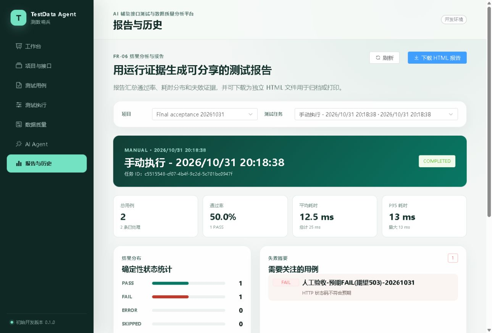

# TestData Agent 人工演示操作手册

操作顺序 预期结果与讲解词

文档编号 TDA DEM 001　文档版本 1.1　适用版本 0.1.0　日期 2026年10月31日

## 一 演示模式与准备

本手册分为免费确定性演示和待授权的真实模型演示。免费演示可以展示人工审核、真实 HTTP 执行、自动断言、报告，以及独立数据质量链路。AI 候选生成、明确授权并执行、调用只读证据工具并分析可能产生模型费用，未取得明确授权时不要点击。

建议免费部分演示 8 至 10 分钟。真实模型部分另预留 6 至 8 分钟，只有凭据、网络、费用授权和人工操作者均就绪后才执行。当前真实模型部分尚未验收，展示时应直说，不能将本机替身实录标作真实模型效果。

### 开始前检查

1. 打开 http://127.0.0.1:5174/，确认左上角是程序员头像和 AI Agent，页面为航天蓝主题。建议使用桌面宽窗口。
2. 访问后端 8084 的 /api/v1/health 和演示 API 8081 的 /demo/health，确认 HTTP 200。不要停止 8080 上的 AutoFlow。
3. 选择专用项目 Final acceptance 20261031。现有项目和证据可以只读展示；如要新建现场数据，用独立演示项目，不覆盖历史用例。
4. 准备 demo-api/openapi.json 与 sample-data 中的 dirty、valid CSV/XLSX、quality-rules.json 和 cleaning-plan.json。
5. 人工操作者在本机掌握有效审批令牌，只在密码框输入。正式展示前先完成凭据安全复核，不在聊天、终端输出、录屏或材料中显示真实值。
6. 录屏前关闭无关窗口和通知，准备记录项目 ID、运行 ID、审批 ID、审计 ID 和质量任务 ID。不要打开安全配置或活动数据库文件。

### 开场讲解词

“这个项目是一套包含自动化接口测试、AI Agent 受控执行和独立数据质量分析的本地平台。测试状态由规则引擎决定，Agent 负责生成候选和解释真实证据。今天先展示已经有证据的确定性功能；真实模型成功调用尚未验收，会单独标明。”

| 阶段 | 建议时长 | 目标 |
| --- | --- | --- |
| 项目与审核 | 2 分钟 | 展示接口契约、草稿及人工审核边界 |
| 执行与报告 | 3 分钟 | 复现 1 PASS 和 1 预期 FAIL，核对报告 |
| 数据质量与清洗 | 3 分钟 | 6 个问题、2 单元格改动、1 行去重 |
| 导出与边界说明 | 2 分钟 | 实际文件核验，说明待验证项 |

<!-- PAGE -->

## 二 接口测试链路操作

### 步骤一 选择项目与查看接口

进入“项目与接口”，选择 Final acceptance 20261031，查看 4 个演示接口和 localhost:8081 基础地址。新环境可创建独立项目并点击“导入”，选择 demo-api/openapi.json 后提交。预期看到 4 个接口；文件选择成功不等于导入提交成功，须核对列表与后端记录。

讲解词：“接口定义先登记，再作为用例与目标约束。导入文档不会自动访问其中的任意地址。当前只对本机演示 API 发请求。”

### 步骤二 展示草稿与审核约束

进入“测试用例”。如需现场演示审核，新建专用 DRAFT，用 GET /demo/health 和状态码断言，不修改已审核历史用例。尝试执行未审核草稿，预期提示只有已启用且已审核用例才能执行，且运行历史不新增任务。

由操作者查看请求和断言后点击“人工审核”，在本机密码框输入审批令牌并提交。预期列表变为已审核，服务端保存当前版本审核记录。若令牌失败，保持草稿并停止该步，不能通过请求参数伪造 REVIEWED。

讲解词：“审核状态由服务端控制。审核绑定用例版本，修改用例后必须重新审核。这里是本机演示权限边界，还没有实现企业账号和 RBAC。”

### 步骤三 选择已审核的两条演示用例

| 用例 | 目标与断言 | 预期结果 |
| --- | --- | --- |
| 人工验收 健康接口 PASS | GET http://localhost:8081/demo/health，期望 HTTP 200 | PASS，实际 200 |
| 人工验收 预期 FAIL 期望503 | 同一目标，故意期望 HTTP 503 | FAIL，实际 200 |

当前页面中的完整用例名称带 20261031 后缀。它们已经由用户本人审核。展示已有审核记录不等于本场重新审核；如需证明现场动作，使用新建的专用草稿完成审核。

### 步骤四 普通引擎执行与证据查看

勾选两条已审核且启用的用例，点击“执行已选 2”，进入“测试执行”查看进度。此处走普通测试运行服务，不调用模型。预期任务最终 COMPLETED，total=2、PASS=1、FAIL=1、ERROR=0。

展开失败明细，核对 expected=503、actual=200，以及真实响应 status=UP。记录这一次新建运行的 ID。已有人工证据运行是 c5515548-cf07-4b4f-9c2d-5c701bc0947f；不要把旧 ID 说成现场新运行。

讲解词：“这条失败是我故意设置的错误预期。系统应该如实保留 FAIL。预期失败证明断言在工作，并不需要把报告改成全绿。”

<!-- PAGE -->

## 三 运行报告与文件核验

该图来自 2026年10月31日的真实人工运行记录，使用主题修改前的界面，仅作为历史验收证据。现场应展示当前蓝色界面和实际选择的运行。

### 步骤五 查看报告

进入“报告与历史”，选择刚执行的任务。预期总数 2、通过率 50.0%、PASS=1、FAIL=1，失败摘要包含错误状态码断言。报告中的 P95、平均耗时会随现场执行变化，不要求复现历史毫秒值。

讲解词：“通过率按 PASS 除以总用例数计算。故意失败仍计入 FAIL。这次是 1/2，即 50%；此前 10 条回归为 9/10，即 90%，属于另一次运行。”

### 步骤六 下载 HTML 报告

点击“下载 HTML 报告”，在浏览器下载列表确认已完成，再打开实际文件。核对文件中的运行 ID、任务名称、总数、50% 统计及失败证据。记录本机保存路径和文件大小。页面出现“开始下载”提示只能证明前端触发了请求，不能代替文件落盘与内容检查。

当前该步骤仍待完成浏览器实际文件复验。此前 HTTP 导出与内容校验通过，不能据此将完整浏览器下载流程签为通过。下载不成功时记录浏览器提示，不修改代码或切换服务来掩盖问题。

<!-- PAGE -->

## 四 独立数据质量链路操作

### 步骤七 上传并解析

进入“数据质量”，确认当前项目，选择 sample-data/quality-dirty.csv，点击“上传并解析”。预期新增任务，3 行、5 列，字段为 id、name、age、score、active，空值率 6.67%。刚解析时问题为 0 表示尚未检测。

随后用 quality-dirty.xlsx 独立完成一次页面选择和上传，预期解析为相同数据。当前 CSV 页面上传已有证据，XLSX 页面上传待补验；已有 XLSX 任务来自 API 验证，不能代替这一步。

### 步骤八 配置规则并检测

| 字段 | 类型 | 必填 | 范围或规则 |
| --- | --- | --- | --- |
| id | 整数 | 是 | 重复业务键选择 id |
| name | 文本 | 是 | 无数值范围 |
| age | 整数 | 是 | 18 至 65 |
| score | 小数 | 是 | 0 至 100 |
| active | 布尔 | 是 | true 或 false |

输入最小值和最大值后移开焦点，确认表单值仍然正确，再点击“开始检测”。预期状态 ANALYZED，发现 6 个问题：文件第 3 行 name 缺失、age 类型错误、score=101 越界；文件第 4 行 id 重复、age=17 越界、score=-1 越界。文件表头计第 1 行。

讲解词：“这些问题由确定性规则产生，可以定位到文件行号和字段。重复检测会更新本次问题记录，不应把同样的六个问题不断累加。”

### 步骤九 清洗预览

启用首尾空白清理，给 name 设置空值替换 Unknown，启用去重并选择 id 作为业务键，保留首次记录。点击“生成清洗预览”。预期修改 2 个单元格、移除 1 条重复记录、输出 2 行；原任务和原上传文件保持 3 行。

讲解词：“清洗先生成预览，再导出新文件，原文件保留。当前规则清理空白、补空和去重，保留行中的 not-number 与 101 仍是质量问题，没有宣称自动修复全部错误。”

### 步骤十 导出 CSV 和 XLSX

分别点击“清洗后 CSV”和“清洗后 XLSX”，在实际下载文件中核对 5 列、2 条数据，name 为 Alice 和 Unknown。CSV 应含 UTF-8 BOM；XLSX 应包含 Data 工作表、表头冻结与筛选，数字及布尔类型符合已有质量规则；无法转换的值不能伪装成有效数字。

记录实际文件名、字节数和 SHA-256。导出后重新查看原任务仍为 3 行。当前浏览器落盘复验尚未完成，不能只凭按钮提示勾选通过。可以再上传 quality-valid.csv 或 XLSX，按相同规则检测，预期为 0 问题；该正常样例不是 dirty 清洗输出。

<!-- PAGE -->

## 五 真实模型演示的授权后步骤

本节是操作预案，当前不表示已经执行。免费模式不要点击三个模型按钮：生成候选用例、明确授权并执行、调用只读证据工具并分析。读取状态或展示已有审计不是新的真实模型成功调用。

### 步骤十一 真实生成与人工接收

取得明确付费授权后，先确认真实上游配置、网络、模型名称、超时和本轮请求预算，不输出密钥。在“AI Agent 中心”选择已登记的演示接口，生成重点填写正常、异常、边界场景，数量选择 3，点击“生成候选用例”。

预期得到三类结构化候选，逐条检查请求和断言，接收后保存为 AGENT/DRAFT。核对服务端 JSON 与业务校验结果；未审核执行仍应被拒绝。记录模型实际名称、调用时间和脱敏请求标识。只配置模型名称不算成功。

讲解词：“模型先提出候选，服务端校验后仍保存为草稿。候选有无测试价值需要人工检查，不会因为模型说可以就自动获得执行权限。”

### 步骤十二 人工审核和执行授权

操作者本人检查候选并在本机审核，通过后选择已审核用例，点击“明确授权并执行”，在密码框完成本次执行授权。该操作可能触发两轮模型请求，必须属于已批准范围。

预期 execute_test_run 只能复制审批绑定参数，通过项目、版本、审核记录、白名单和幂等校验后创建运行。记下 agentTaskId、approvalId、auditId、runId。重复同请求应返回原任务，参数冲突应拒绝；不要为了演示防重反复使用新键。

若提示工具超时，先用页面状态查询和 GET /agent/executions/{approvalId} 确认是否已有运行，不再次授权。工具审计的 SUCCESS 仅代表工具任务创建阶段，测试可能仍 RUNNING 或最终 FAIL。

### 步骤十三 真实失败分析与报告

选择一个可复现的真实失败运行，点击“调用只读证据工具并分析”。预期分析引用真实 resultId、失败断言的期望与实际值、响应摘要，并给出与证据相符的复测建议。

分析前后分别读取原运行及断言，确认 PASS/FAIL 未改变。核对证据工具审计与运行 ID。模型不可用、超时或非法 JSON 时记录失败，保留原判定，不用模拟成功内容替代真实验收。

讲解词：“模型解释的依据是已经保存的证据。它没有修改结果的接口，分析失败时，接口测试和报告依然可以使用。”

本节通过标准是实际真实调用、人工本人审核授权、受控执行、审计关联和证据分析全部有记录。当前状态为尚未验证，不应在求职材料中写成真实模型验收完成。

<!-- PAGE -->

## 六 录屏分镜与异常处理

| 镜头 | 操作画面 | 讲解重点 | 需保留的证据 |
| --- | --- | --- | --- |
| 1 约30秒 | 蓝色工作台与架构图 | 系统定位及两条独立链路 | 当前入口、时间与版本 |
| 2 约90秒 | 接口、草稿、人工审核 | 服务端审核和版本约束 | DRAFT 与审核后状态 |
| 3 约120秒 | 批量执行及失败明细 | 真实 HTTP 与确定性断言 | 新运行 ID、预期503实际200 |
| 4 约60秒 | 报告与实际 HTML 文件 | 50% 统计与预期失败规则 | 同一运行 ID、下载文件 |
| 5 约150秒 | 上传、6问题与清洗预览 | 检测与派生清洗分别负责什么 | 3行到2行、修改2与去重1 |
| 6 约90秒 | CSV XLSX 文件与验收表 | 文件内容、原始数据保留及边界 | 实际落盘路径与校验值 |
| 可选真实AI | 候选、本人审核授权、工具审计与分析 | 证据约束和判定隔离 | 模型调用及四类关联 ID |

分镜是待录制方案，目前没有视频文件。替身截图或历史录屏须加“本机协议替身”或“历史验收记录”标识。录制本人审批时暂停或遮挡密码框与相关安全提示，不展示真实令牌。

### 异常处理表

| 现场现象 | 处理与判定 |
| --- | --- |
| 审核失败 | 只记录错误提示；维护者本机检查令牌和后端配置；保持 DRAFT，不绕过审核 |
| 请求目标不在白名单 | 确认只使用 localhost:8081 的登记演示接口，不临时放开任意地址 |
| 运行仍在进行 | 查询已有任务，等真实终态，不把 HTTP 200 当作测试 PASS |
| 工具等待超时 | 使用原 approvalId 查询，避免新键重复授权；保留超时审计 |
| 模型失败或没有费用授权 | 跳过真实AI演示，标为未验证；继续确定性功能 |
| 下载仅有提示 | 打开下载列表并核对本机文件；无文件则标记阻塞或未验证 |
| 清洗后仍有 not-number 或101 | 说明规则范围，展示后续质量问题；不要宣称已全部修复 |

### 演示结束记录

记录项目 ID、用例版本及审核时间、实际运行 ID、结果统计、报告 ID、质量任务 ID、导出文件路径与 SHA-256。真实模型演示额外记录模型名称、审批与审计关联、异常状态和费用授权范围。只填写实际发生的结果，失败或跳过也保留记录。

结束讲解词：“核心确定性测试和数据质量功能已有可复现结果。Agent 的权限、工具和证据约束已通过本机替身与隔离测试；真实模型成功链路仍按独立验收项管理。下一步是补齐这些验证并形成完整演示视频。”
